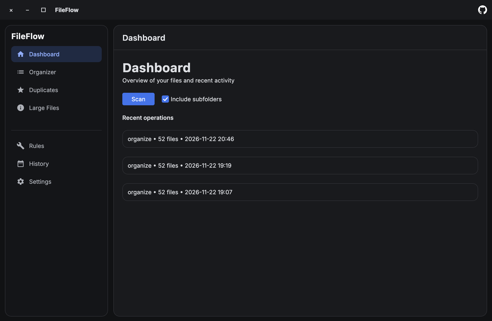
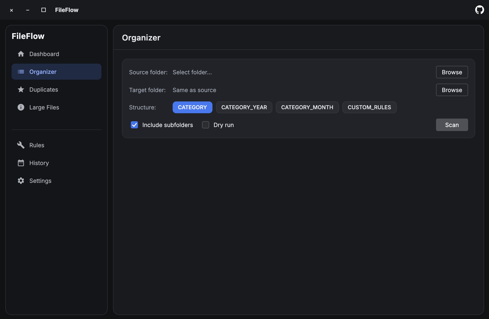
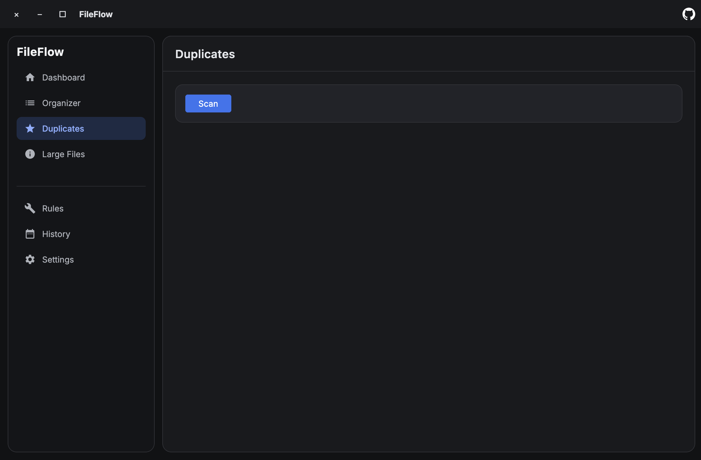
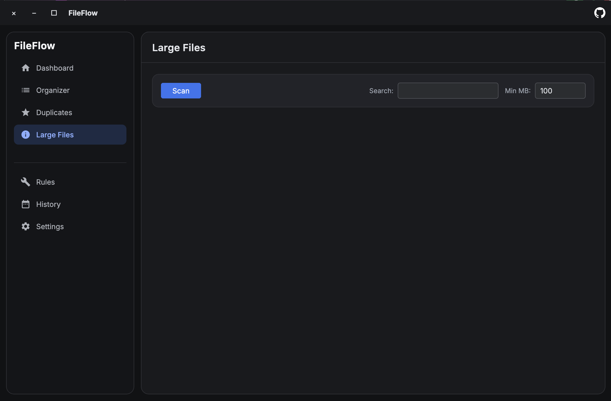
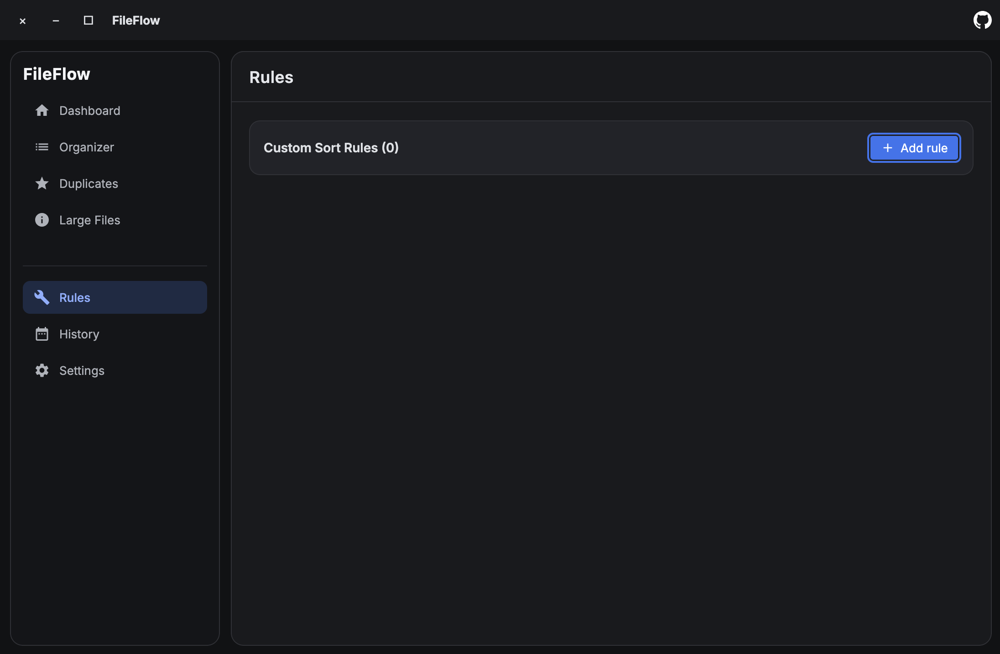
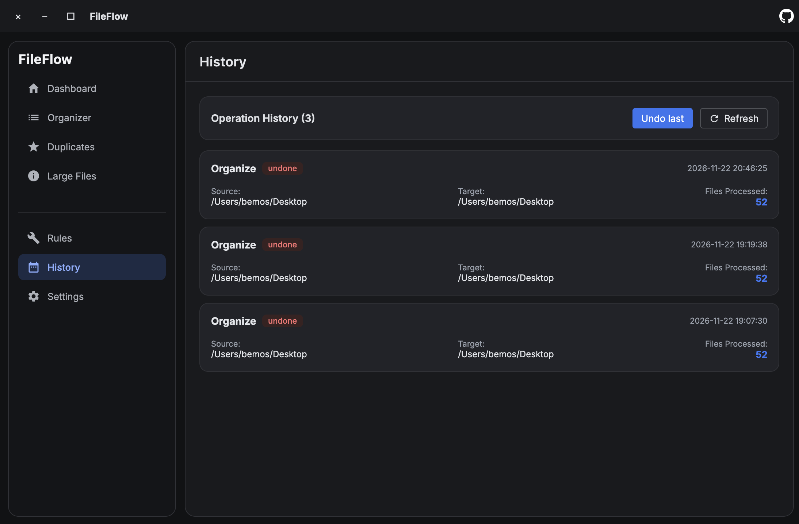
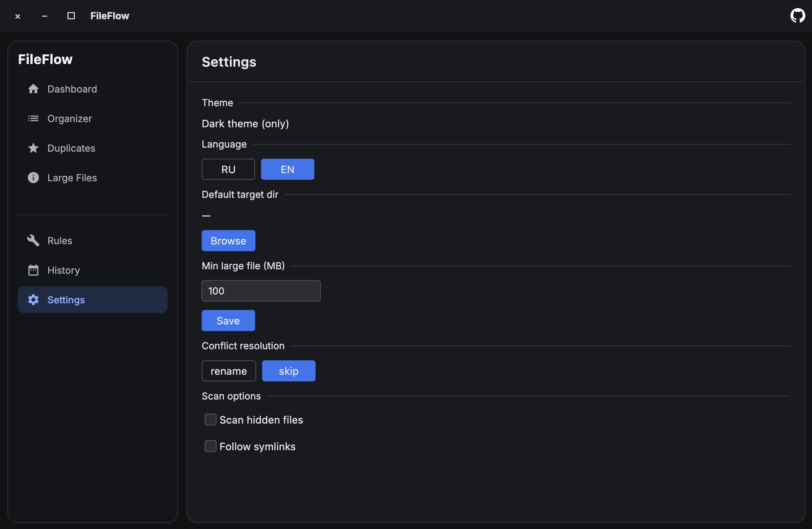

[Русский](README.md) | [English](README.en.md)

# FileFlow

FileFlow is a local application for organizing files on your computer.

## Screenshots

### Dashboard


Main dashboard: statistics, category distribution and recent operations.

### Organizer


Folder selection, structure, preview and execution of sorting.

### Duplicates


Find identical files by SHA-256 and delete selected.

### Large Files


Find and filter large files, reveal location.

### Rules


Create and manage sorting rules.

### History


Operation log and undo last sorting.

### Settings


Language, theme, scan options and behavior.

## Features

- Recursive folder scanning
- Automatic categorization by extension
- Preview before moving
- Duplicate finder (SHA-256)
- Large files finder
- Custom rules with priorities
- Operation history and undo
- Dark theme, Russian/English UI

## Tech stack

- Kotlin 2.1
- Compose Multiplatform Desktop 1.7
- Gradle Kotlin DSL
- Coroutines / Flow
- kotlinx.serialization
- Java NIO
- SQLite

## Run

```bash
./gradlew :app:run
```

Requires JDK 21 (JBR recommended).

## Build

```bash
./gradlew :app:packageDistributionForCurrentOS
```

## License

Section reserved for later decision.
