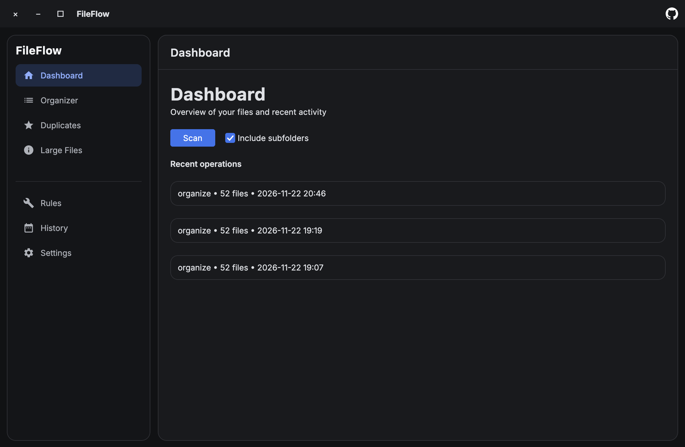
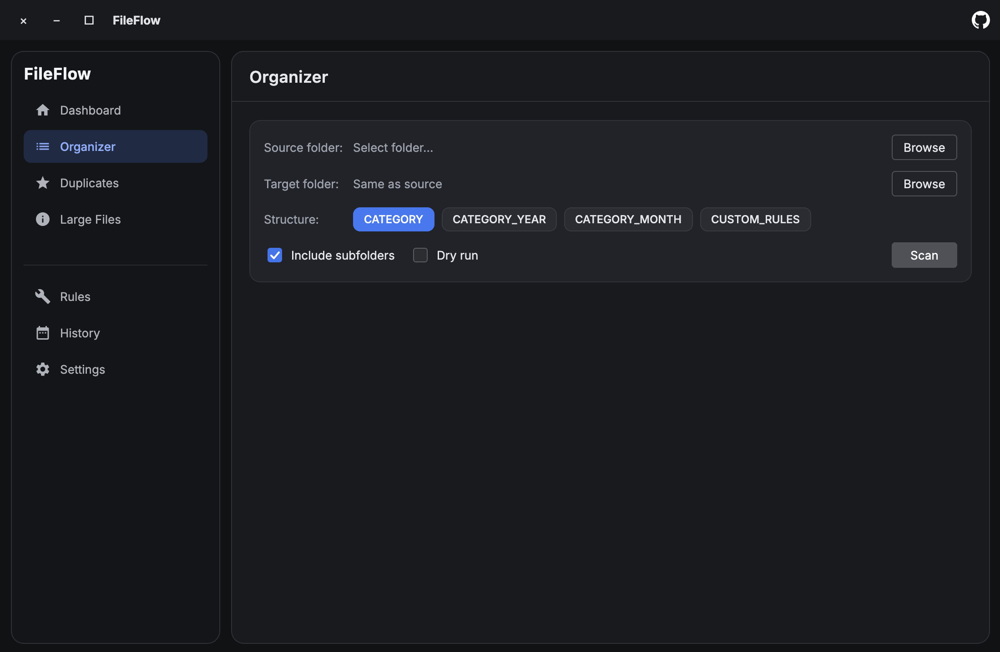
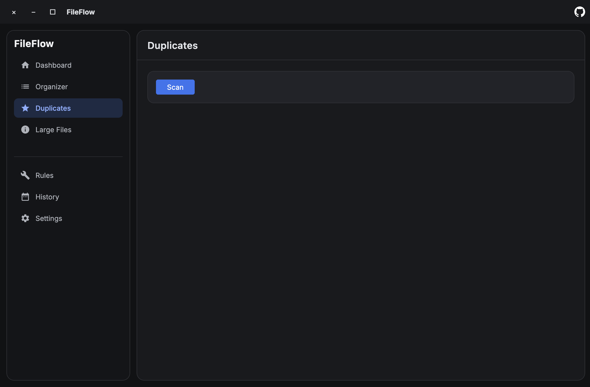
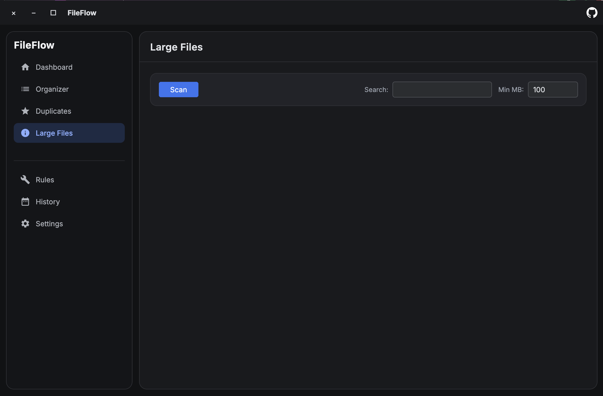
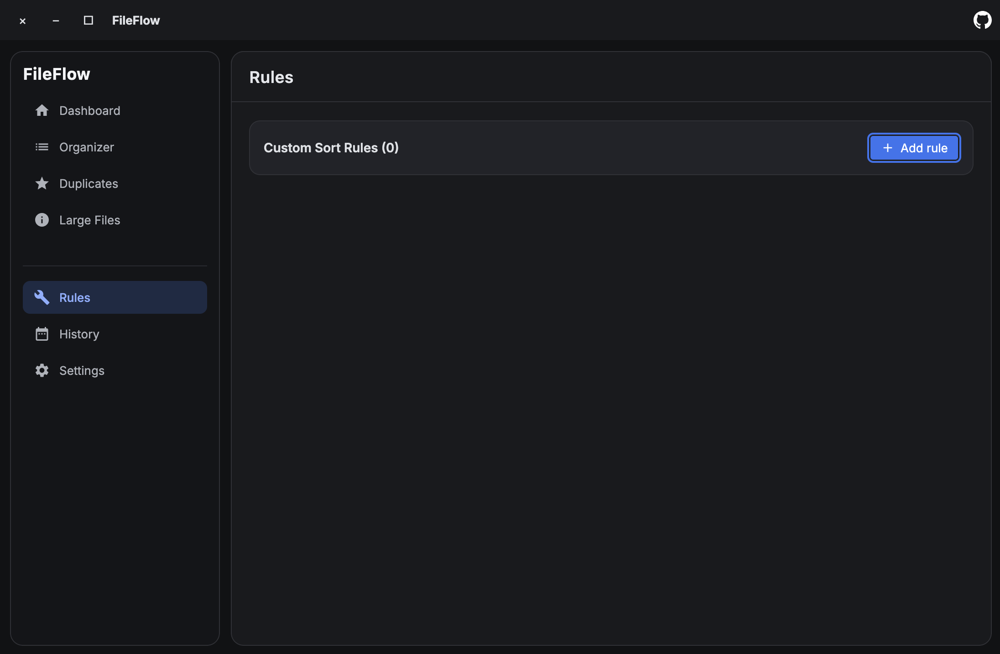
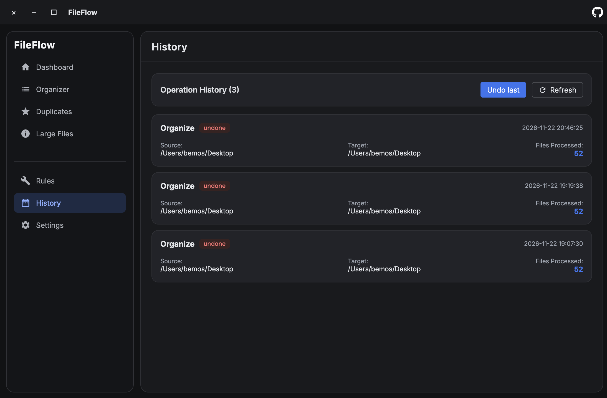
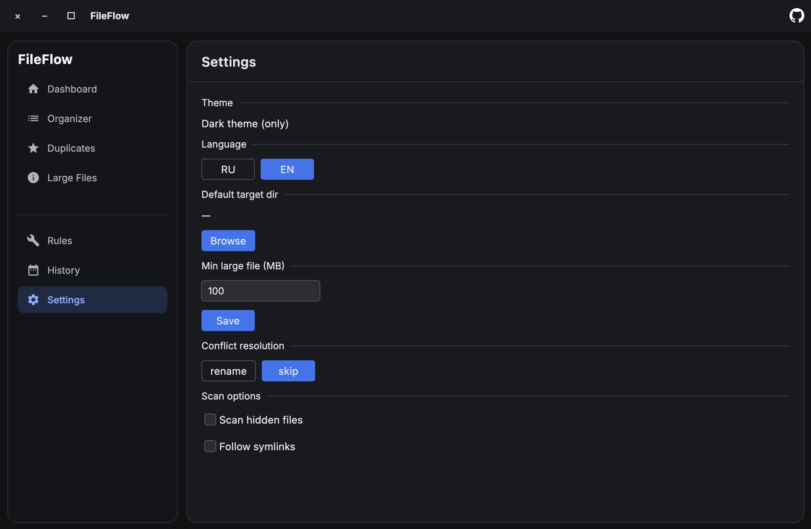

# FileFlow

FileFlow — локальное приложение для организации файлов на компьютере.

## Скриншоты

### Панель


Главная панель: статистика, распределение по категориям и последние операции.

### Организатор


Выбор папок, структура, предпросмотр и выполнение сортировки.

### Дубликаты


Поиск одинаковых файлов по SHA-256 и удаление выбранных.

### Большие файлы


Поиск и фильтрация крупных файлов, раскрытие расположения.

### Правила


Создание и управление правилами сортировки.

### История


Журнал операций и отмена последней сортировки.

### Настройки


Язык, тема, параметры сканирования и поведение.

## Возможности

- Рекурсивное сканирование папок
- Автоматическая категоризация по расширениям
- Предпросмотр перед перемещением
- Поиск дубликатов (SHA-256)
- Поиск больших файлов
- Пользовательские правила с приоритетами
- История операций и отмена
- Тёмная тема, русский/английский интерфейс

## Стек

- Kotlin 2.1
- Compose Multiplatform Desktop 1.7
- Gradle Kotlin DSL
- Coroutines / Flow
- kotlinx.serialization
- Java NIO
- SQLite

## Запуск

```bash
./gradlew :app:run
```

Требуется JDK 21 (рекомендуется JBR).

## Сборка

```bash
./gradlew :app:packageDistributionForCurrentOS
```

## Лицензия

Раздел для последующего решения.

---

[Русский](README.md) | [English](README.en.md)
